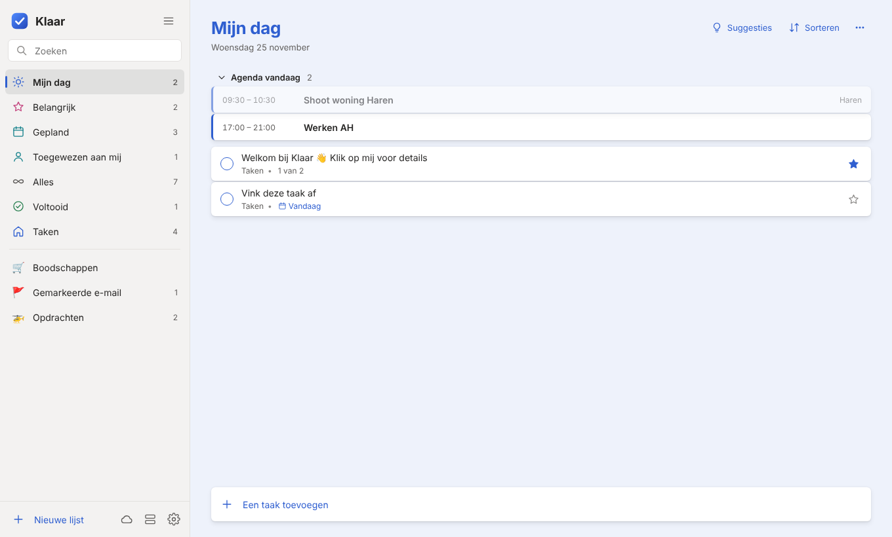
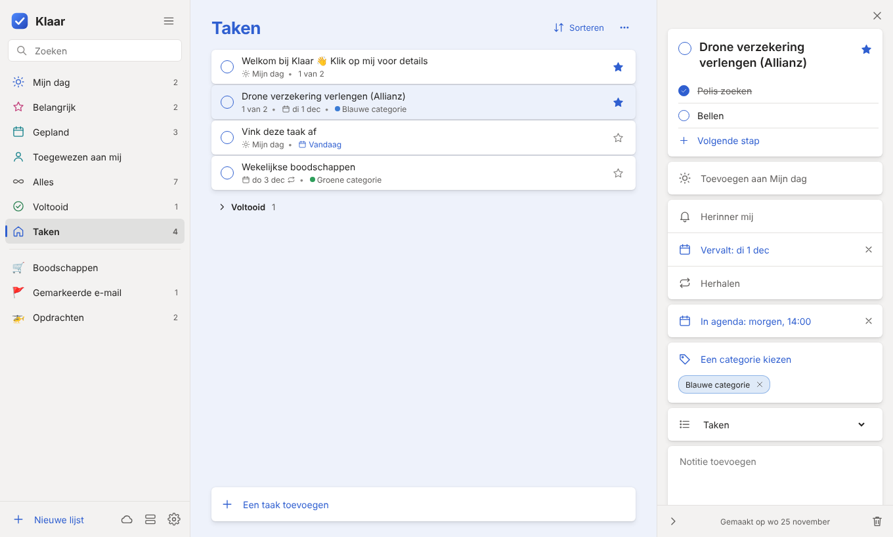
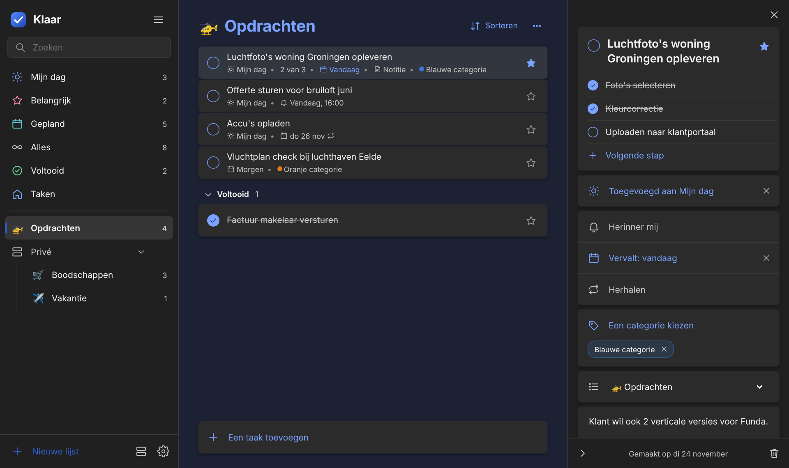
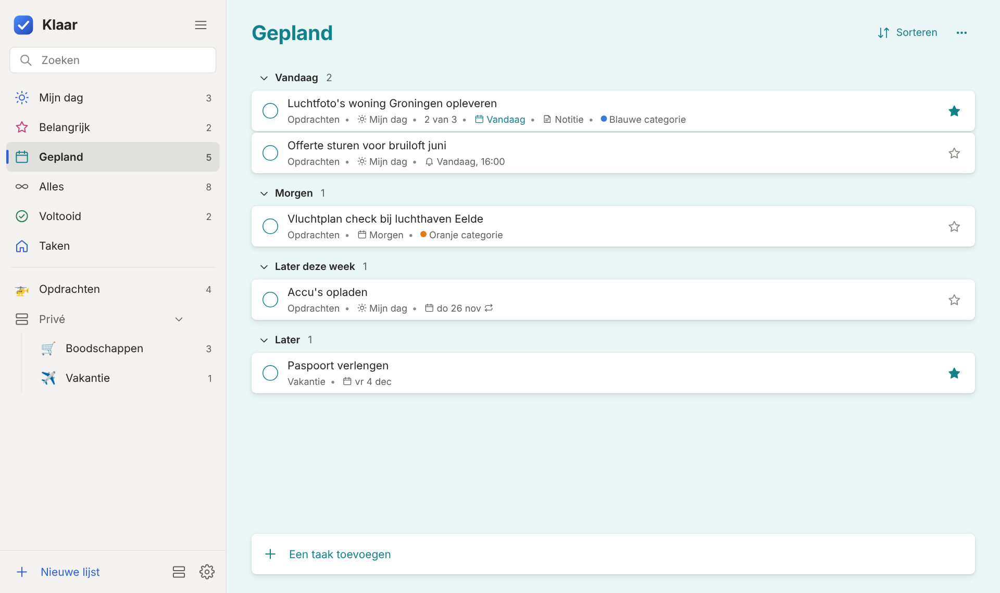

<p align="center">
  
</p>

<h1 align="center">Klaar</h1>

<p align="center">
  Een snelle, gratis en offline takenapp, geïnspireerd op Microsoft To Do.<br>
  Voor Windows, macOS, Linux en in de browser.
</p>

<p align="center">
  <a href="../../releases/latest"><b>⬇️ Download de nieuwste versie</b></a>
</p>


## Functies

### Koppeling met Microsoft
- **Synchronisatie met Microsoft To Do, twee kanten op**: lijsten (met emoji), taken, stappen, ster, vervaldatum, herinnering, herhalen, notities en categorieën. Wat je in Klaar doet, staat ook in To Do op je telefoon, en andersom
- **Gemarkeerde e-mail** uit Outlook verschijnt als lijst, met een knop om de mail te openen
- **Outlook-agenda in Mijn dag**: je afspraken van vandaag boven je taken
- **Taken inplannen in je agenda**: maak van een taak met één klik een Outlook-afspraak
- **Automatische back-up naar OneDrive**: dagelijks, in een eigen app-map, en terug te zetten op een andere pc
- **Toegewezen aan mij**: taken uit Planner en Teams (werk- of schoolaccount)

### Taken
- **Mijn dag**: een dagplanner die elke ochtend weer leeg begint, met **suggesties** (te laat, vandaag, van eerdere dagen, binnenkort, belangrijk)
- **Slimme lijsten**: Belangrijk, Gepland (gegroepeerd op Eerder / Vandaag / Morgen / Later deze week / Later), Alles, Voltooid en Taken
- **Eigen lijsten** met emoji-pictogram en kleurthema, plus **groepen** om lijsten te bundelen
- **Stappen** (subtaken), **vervaldatums**, **herinneringen**, **herhalende taken** (ook "elke 2 weken op di en do"), **categorieën**, **notities** en **ster voor belangrijk**
- **Slim typen**: typ `morgen 9:00 offerte sturen ! #rood @werk` en Klaar zet de datum, herinnering, ster, categorie en lijst automatisch
- **Sorteren**, **slepen**, **zoeken**, rechtermuisknop-menu's, **ongedaan maken**, afdrukken, **donkere modus**, Nederlands en Engels

### Desktop
- **Pictogram in het systeemvak** en optioneel **sluiten naar systeemvak**, zodat herinneringen blijven werken
- **Sneltoets** (standaard `Ctrl+Alt+K`): een klein venster om overal snel een taak toe te voegen
- **Opstarten met Windows/macOS**
- **Automatische updates** via GitHub Releases (Windows en Linux)
- **Agenda-export (.ics)** en **back-up** als JSON
- Werkt volledig **offline**. Zonder Microsoft-account blijft alles op je eigen computer

### Slim typen

| Je typt | Klaar maakt ervan |
|---|---|
| `morgen`, `overmorgen`, `vrijdag`, `volgende week`, `12 dec`, `5-12`, `over 3 dagen` | vervaldatum |
| `9:00`, `14.30`, `om 8u`, `7pm` | herinnering op dat tijdstip |
| `elke dag`, `werkdagen`, `elke maandag en donderdag`, `elke 2 weken`, `maandelijks` | herhalen |
| `!` | belangrijk (ster) |
| `*` | toevoegen aan Mijn dag |
| `#blauw`, `#rood`, `#groen`, … | categorie |
| `@lijstnaam` | in die lijst zetten (het begin van de naam is genoeg) |

Werkt ook in het Engels (`tomorrow 9am`, `every monday`). Uitzetten kan in Instellingen → Algemeen.

<details>
<summary>Meer screenshots</summary>






</details>

## Installeren

Ga naar [**Releases**](../../releases/latest) en download het bestand voor jouw systeem:

| Systeem | Bestand |
|---|---|
| Windows (installer) | `Klaar-Setup-x.y.z.exe` |
| Windows (zonder installatie) | `Klaar-Portable-x.y.z.exe` |
| macOS, Apple Silicon (M1–M4) | `Klaar-x.y.z-arm64.dmg` |
| macOS, Intel | `Klaar-x.y.z-x64.dmg` |
| Linux | `Klaar-x.y.z-x86_64.AppImage` of `Klaar-x.y.z-amd64.deb` |

**Waarschuwing bij het openen?** De app is niet digitaal ondertekend (dat kost honderden euro's per jaar), dus je systeem waarschuwt de eerste keer:

- **Windows**: klik bij "Windows heeft uw pc beschermd" op *Meer informatie* → *Toch uitvoeren*.
- **macOS**: sleep Klaar naar Programma's, klik met de rechtermuisknop op de app → *Open* → *Open*. Werkt dat niet, voer dan dit commando eenmalig uit in Terminal: `xattr -cr /Applications/Klaar.app`
- **Linux (AppImage)**: `chmod +x Klaar-*.AppImage` en daarna dubbelklikken.

### In de browser

Klaar werkt ook als website (je taken worden dan in je browser bewaard). Na het aanzetten van GitHub Pages (zie hieronder) staat hij op `https://anonymous2345566.github.io/Have-Done/`.

## Zelf bouwen vanaf de broncode

Je hebt [Node.js](https://nodejs.org) 18 of nieuwer en Git nodig.

```bash
git clone https://github.com/anonymous2345566/Have-Done.git
cd Have-Done
npm install
npm start          # app starten
```

Een installer maken voor je eigen systeem:

```bash
npm run dist       # resultaat in de map dist/
npm run dist:win   # of specifiek: :win, :mac, :linux
```

Alleen de webversie draaien, zonder Electron: `npm run web` en open `http://localhost:5173`.

Tests draaien: `npm test`.

## Microsoft-koppeling instellen (eenmalig, voor de beheerder)

Om in te loggen met Microsoft heeft Klaar een gratis **app-registratie** in Microsoft Entra nodig. Die maak je één keer aan. Daarna kan iedereen die Klaar downloadt gewoon op "Inloggen met Microsoft" klikken.

1. Ga naar **https://entra.microsoft.com** en log in met je Microsoft-account. Heb je nog geen Entra/Azure-omgeving? Maak dan eerst een gratis account aan via https://azure.microsoft.com/free; je hebt alleen de gratis "Default Directory" nodig.
2. Ga naar **Applicaties → App-registraties → Nieuwe registratie**.
   - **Naam**: `Klaar`
   - **Ondersteunde accounttypen**: *Accounts in een organisatiedirectory en persoonlijke Microsoft-accounts* ("Any Entra ID Tenant + Personal Microsoft accounts")
   - Klik op **Registreren**.
3. Kopieer op de overzichtspagina de **Application (client) ID**.
4. Ga naar **Verificatie (Authentication) → Een platform toevoegen**:
   - **Mobiele en bureaubladtoepassingen** met als omleidings-URI: `http://localhost` (voor de desktop-app)
   - **Toepassing met één pagina (SPA)** met als omleidings-URI: `https://anonymous2345566.github.io/Have-Done/` (voor de webversie)
5. Ga naar **API-machtigingen → Een machtiging toevoegen → Microsoft Graph → Gedelegeerde machtigingen** en voeg toe: `Tasks.ReadWrite`, `Calendars.ReadWrite`, `Files.ReadWrite.AppFolder`, `User.Read`, `offline_access`. Je hoeft geen client-secret aan te maken; Klaar gebruikt de veilige PKCE-inlogmethode zonder geheimen.
6. Zet de Client ID in je repo: **Settings → Secrets and variables → Actions → tabblad Variables → New repository variable**, met als naam `MS_CLIENT_ID` en als waarde de Client ID. Elke nieuwe release en de webversie krijgen hem dan automatisch ingebouwd. (Of zet hem direct in `src/config.js`. Een Client ID is openbaar en geen wachtwoord.)
7. Maak een nieuwe release (zie hieronder). Klaar → Instellingen → Microsoft → **Inloggen met Microsoft**.

> Werk- of schoolaccounts: sommige organisaties staan apps van niet-geverifieerde uitgevers niet toe. Dan moet een beheerder van die organisatie eenmalig toestemming geven. Persoonlijke accounts (Outlook.com, Hotmail, Live) werken altijd.

Gebruikers kunnen ook hun eigen app-registratie gebruiken via Instellingen → Microsoft → *Geavanceerd*.

**Zo werkt de synchronisatie:** elke 2 minuten, een paar seconden na elke wijziging, en als je het venster weer opent. Klaar haalt alleen wijzigingen op (delta-query's), dus het gaat snel. Bij een conflict wint de laatste wijziging. "Mijn dag", groepen en kleurthema's zijn alleen in Klaar, omdat de To Do-koppeling van Microsoft die niet ondersteunt.

**Privacy:** in de desktop-app worden je Microsoft-tokens versleuteld opgeslagen via de beveiligde opslag van je besturingssysteem en komen ze nooit in de app-interface. Klaar praat alleen met Microsoft; er is geen tussenserver.

## Waar staan mijn taken?

| Systeem | Locatie |
|---|---|
| Windows | `%APPDATA%\Klaar\klaar-data.json` |
| macOS | `~/Library/Application Support/Klaar/klaar-data.json` |
| Linux | `~/.config/Klaar/klaar-data.json` |

Bij elke opslag wordt de vorige versie bewaard als `klaar-data.json.bak`. Via **Instellingen → Back-up exporteren** maak je zelf een kopie.

## Sneltoetsen

| Toets | Actie |
|---|---|
| `Ctrl/⌘ + N` | Nieuwe taak |
| `Ctrl/⌘ + F` | Zoeken |
| `Ctrl/⌘ + L` | Nieuwe lijst |
| `Ctrl/⌘ + 1…9` | Lijst 1 t/m 9 in de zijbalk openen |
| `Ctrl + Alt + K` | Overal snel een taak toevoegen (desktop, instelbaar) |
| `Ctrl/⌘ + Z` | Ongedaan maken |
| `Spatie` | Taak met focus afvinken |
| `Delete` | Taak met focus verwijderen |
| `Esc` | Details of menu sluiten |
| Dubbelklik op titel | Lijst hernoemen |

## Voor de beheerder: een nieuwe versie uitbrengen

Alles gaat automatisch via GitHub Actions:

```bash
git tag v1.0.0
git push origin v1.0.0
```

Na ongeveer 10 minuten staat er een nieuwe **Release** met installers voor Windows, macOS en Linux. Het versienummer in de app wordt automatisch uit de tag gehaald.

**Webversie aanzetten (eenmalig):** *Settings → Pages → Source: GitHub Actions*. Daarna wordt de site bij elke push naar `main` bijgewerkt.

## Projectstructuur

```
main.js            Electron-hoofdproces (venster, systeemvak, sneltoets, updates)
ms-main.js         Microsoft-login (MSAL) en afgeschermde Graph-toegang
preload.js         Veilige brug tussen app en hoofdproces
src/
  index.html       App-shell
  app.js           Weergaven, interactie en logica
  store.js         Datamodel, opslag, Mijn dag-reset, herhalingen
  microsoft.js     To Do-sync, Outlook-agenda, OneDrive, Planner
  nlp.js           Slim typen (NL/EN)
  quickadd.*       Snel-toevoegen-venster
  config.js        Microsoft Client ID
  ui.js            Menu's, dialogen, meldingen
  i18n.js          Vertalingen (NL/EN)
  icons.js         Eigen SVG-pictogrammen
  styles.css       Opmaak, thema's, donkere modus
test/              Unit tests (node --test)
.github/workflows  CI, releases en GitHub Pages
```

Geen framework, geen build-stap voor de interface: gewoon HTML, CSS en JavaScript. Er zijn twee runtime-afhankelijkheden: `@azure/msal-node` (Microsoft-login) en `electron-updater`.

## Licentie

[MIT](LICENSE). Doe ermee wat je wilt.

> Klaar is een onafhankelijk project en is niet verbonden aan, gesponsord door of goedgekeurd door Microsoft. "Microsoft To Do" is een handelsmerk van Microsoft Corporation.
