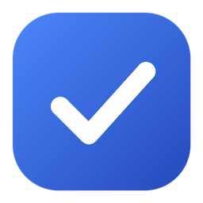
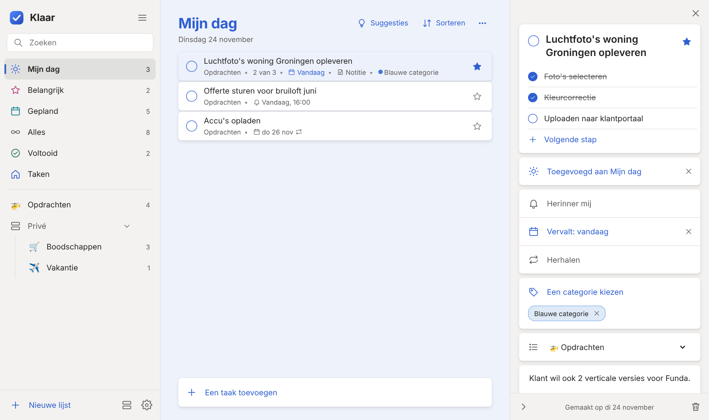

<p align="center">
  
</p>

<h1 align="center">Klaar</h1>

<p align="center">
  Een snelle, gratis en offline takenapp, geïnspireerd op Microsoft To Do.<br>
  Voor Windows, macOS, Linux en in de browser.
</p>

<p align="center">
  <a href="../../releases/latest"><b>⬇️ Download de nieuwste versie</b></a>
</p>



## Functies

- **Mijn dag**: een dagplanner die elke ochtend weer leeg begint, met **suggesties** (te laat, vandaag, van eerdere dagen, binnenkort, belangrijk)
- **Slimme lijsten**: Belangrijk, Gepland (gegroepeerd op Eerder / Vandaag / Morgen / Later deze week / Later), Alles, Voltooid en Taken
- **Eigen lijsten** met emoji-pictogram en kleurthema, plus **groepen** om lijsten te bundelen (inklapbaar, via slepen)
- **Stappen** (subtaken) met voortgang ("2 van 3"), en een stap omzetten in een eigen taak
- **Vervaldatums**, **herinneringen** (systeemmelding + geluid) en **herhalende taken**: dagelijks, werkdagen, wekelijks, maandelijks, jaarlijks of aangepast ("elke 2 weken op di en do")
- **Categorieën** (6 kleuren, zelf te hernoemen), **notities** en **ster voor belangrijk**
- **Sorteren** op prioriteit, vervaldatum, Mijn dag, alfabet of aanmaakdatum
- **Slepen**: taken herschikken, naar een andere lijst slepen, of naar Mijn dag / Belangrijk / Gepland
- **Zoeken** in titels, notities, stappen en categorieën
- Rechtermuisknop-menu's, **ongedaan maken**, afdrukken, **donkere modus**, Nederlands en Engels
- **Back-up** exporteren en importeren (JSON)
- Volledig **offline**: geen account, geen tracking, je data blijft op je eigen computer

<details>
<summary>Meer screenshots</summary>


</details>

## Installeren

Ga naar [**Releases**](../../releases/latest) en download het bestand voor jouw systeem:

| Systeem | Bestand |
|---|---|
| Windows (installer) | `Klaar-Setup-x.y.z.exe` |
| Windows (zonder installatie) | `Klaar-Portable-x.y.z.exe` |
| macOS, Apple Silicon (M1–M4) | `Klaar-x.y.z-arm64.dmg` |
| macOS, Intel | `Klaar-x.y.z-x64.dmg` |
| Linux | `Klaar-x.y.z-x86_64.AppImage` of `Klaar-x.y.z-amd64.deb` |

**Waarschuwing bij het openen?** De app is niet digitaal ondertekend (dat kost honderden euro's per jaar), dus je systeem waarschuwt de eerste keer:

- **Windows**: klik bij "Windows heeft uw pc beschermd" op *Meer informatie* → *Toch uitvoeren*.
- **macOS**: sleep Klaar naar Programma's, klik met de rechtermuisknop op de app → *Open* → *Open*. Werkt dat niet, voer dan dit commando eenmalig uit in Terminal: `xattr -cr /Applications/Klaar.app`
- **Linux (AppImage)**: `chmod +x Klaar-*.AppImage` en daarna dubbelklikken.

### In de browser

Klaar werkt ook als website (je taken worden dan in je browser bewaard). Na het aanzetten van GitHub Pages (zie hieronder) staat hij op `https://JOUW-GEBRUIKERSNAAM.github.io/klaar/`.

## Zelf bouwen vanaf de broncode

Je hebt [Node.js](https://nodejs.org) 18 of nieuwer en Git nodig.

```bash
git clone https://github.com/JOUW-GEBRUIKERSNAAM/klaar.git
cd klaar
npm install
npm start          # app starten
```

Een installer maken voor je eigen systeem:

```bash
npm run dist       # resultaat in de map dist/
npm run dist:win   # of specifiek: :win, :mac, :linux
```

Alleen de webversie draaien, zonder Electron: `npm run web` en open `http://localhost:5173`.

Tests draaien: `npm test`.

## Waar staan mijn taken?

| Systeem | Locatie |
|---|---|
| Windows | `%APPDATA%\Klaar\klaar-data.json` |
| macOS | `~/Library/Application Support/Klaar/klaar-data.json` |
| Linux | `~/.config/Klaar/klaar-data.json` |

Bij elke opslag wordt de vorige versie bewaard als `klaar-data.json.bak`. Via **Instellingen → Back-up exporteren** maak je zelf een kopie.

## Sneltoetsen

| Toets | Actie |
|---|---|
| `Ctrl/⌘ + N` | Nieuwe taak |
| `Ctrl/⌘ + F` | Zoeken |
| `Ctrl/⌘ + L` | Nieuwe lijst |
| `Ctrl/⌘ + Z` | Ongedaan maken |
| `Spatie` | Taak met focus afvinken |
| `Delete` | Taak met focus verwijderen |
| `Esc` | Details of menu sluiten |
| Dubbelklik op titel | Lijst hernoemen |

## Voor de beheerder: een nieuwe versie uitbrengen

Alles gaat automatisch via GitHub Actions:

```bash
git tag v1.0.0
git push origin v1.0.0
```

Na ongeveer 10 minuten staat er een nieuwe **Release** met installers voor Windows, macOS en Linux. Het versienummer in de app wordt automatisch uit de tag gehaald.

**Webversie aanzetten (eenmalig):** *Settings → Pages → Source: GitHub Actions*. Daarna wordt de site bij elke push naar `main` bijgewerkt.

## Projectstructuur

```
main.js            Electron-hoofdproces (venster, opslag op schijf)
preload.js         Veilige brug tussen app en opslag
src/
  index.html       App-shell
  app.js           Weergaven, interactie en logica
  store.js         Datamodel, opslag, Mijn dag-reset, herhalingen
  ui.js            Menu's, dialogen, meldingen
  i18n.js          Vertalingen (NL/EN)
  icons.js         Eigen SVG-pictogrammen
  styles.css       Opmaak, thema's, donkere modus
test/              Unit tests (node --test)
.github/workflows  CI, releases en GitHub Pages
```

Geen framework, geen build-stap voor de interface: gewoon HTML, CSS en JavaScript.

## Licentie

[MIT](LICENSE). Doe ermee wat je wilt.

> Klaar is een onafhankelijk project en is niet verbonden aan, gesponsord door of goedgekeurd door Microsoft. "Microsoft To Do" is een handelsmerk van Microsoft Corporation.
